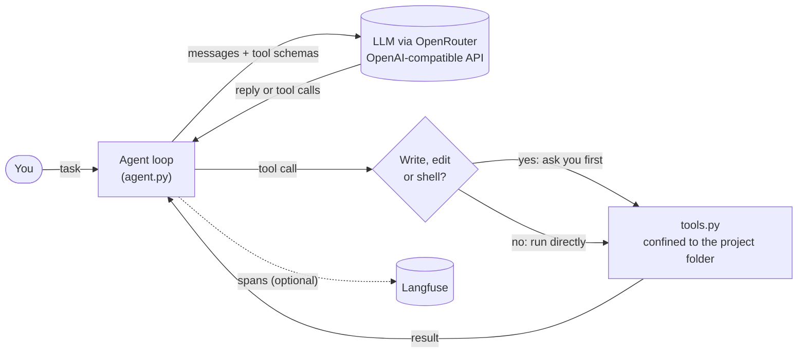
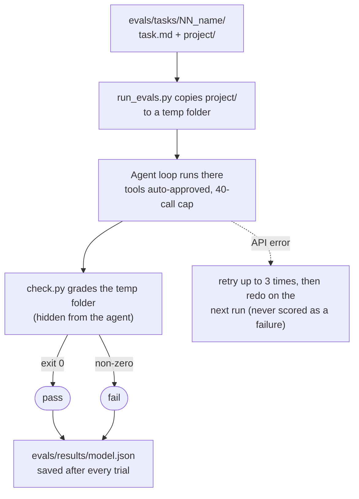
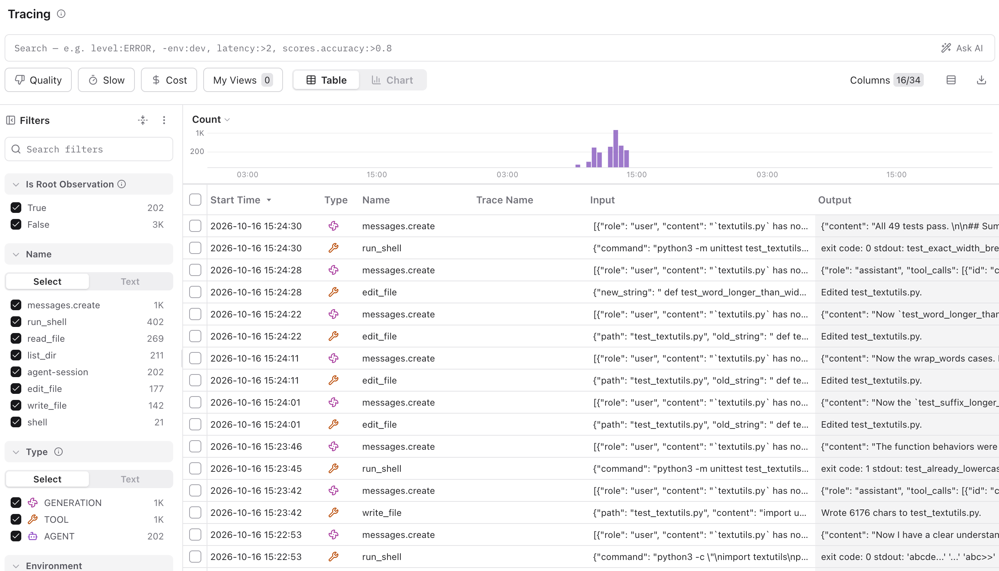

# agent-bench

A small coding agent and a benchmark for measuring how well different LLMs drive it.

The agent is a plain tool-use loop (read, write and edit files, run shell commands) that works with any
OpenAI-compatible API. The benchmark gives it ten small programming tasks, grades each result with a hidden
test, and reports pass rate, steps, tokens and time per model. It is set up to compare **free** models on
[OpenRouter](https://openrouter.ai), with every run traced in [Langfuse](https://langfuse.com).

## How it works

```
agent.py          the agent loop: model call -> tool calls -> results -> repeat
tools.py          list_dir, read_file, write_file, edit_file, run_shell (confined to the project folder)
tracing.py        optional Langfuse tracing; does nothing unless the Langfuse keys are set
evals/
  run_evals.py    runs every task against a model and grades the result
  tasks/NN_name/
    task.md       the instruction the agent receives
    project/      the starting files the agent works on
    solution/     a reference fix, used only to validate the task
    check.py      hidden grader; the agent never sees it
```

### The agent loop



The loop sends the conversation and the tool definitions to the model. If the model replies with tool calls, the
loop runs them, appends the results and asks again, until the model answers without a tool call (or hits the
40-call cap). Tool results that are errors go back to the model as text, so it can recover.

### The benchmark



For each task the runner copies `project/` to a temp folder, lets the agent work with auto-approved tools,
then runs `check.py` in that folder. Exit code 0 is a pass. Nobody judges the output by eye.

## The tasks

| # | Task | What it tests |
|---|---|---|
| 01 | Make functions return `None` on empty input | A small, well-specified bug fix |
| 02 | Add a `--json` flag to a CLI | New code that matches existing style, without changing default output |
| 03 | Fix failing tests with one root cause | Diagnosing a float-truncation bug; the tests must not be edited |
| 04 | Split a module in two | Multi-file refactor that keeps the old imports working |
| 05 | Write tests for a module | Graded by mutation: the tests must pass on the real code and catch at least 5 of 6 injected bugs |
| 06 | Fix a crash on messy CSV data | Error recovery; the data file is restored before grading, so it cannot be "fixed" |
| 07 | Fix pagination | Two bugs at once: an off-by-one and a rounding-down page count |
| 08 | Implement `parse_duration` from a docstring | Building to a spec, including invalid-input handling |
| 09 | Rename a function everywhere | Multi-file edits, including docstrings and aliased imports |
| 10 | Fix state leaking between calls | A trap: a shallow copy looks right but fails on nested data |

## Keeping the benchmark honest

- **Every task is validated.** `python evals/run_evals.py --validate` checks that each task fails before any
  changes and passes with its reference solution, so a broken grader can't skew the results.
- **Hidden graders.** `check.py` lives outside the agent's working folder.
- **No credit for API trouble.** Rate-limit and API errors are retried and reported in their own column. They are
  never counted as the model failing a task.
- **Resumable.** Results are saved after every trial. Rerunning the same command skips finished trials and
  redoes the ones that hit errors, and the run stops cleanly if the daily free-request limit is reached.
- **Multiple trials.** Models are non-deterministic. Use `--trials 3` or more and read pass rates, not single runs.

## Results

Three free OpenRouter models, 10 tasks, 2 trials each (20 trials per model), run on 2026-10-16. Trials that hit
API rate limits were rerun and are not counted, so every number below comes from a trial that got model answers
throughout. Raw per-trial data is in [`evals/results/`](evals/results/).

| Model | Passed | Avg steps | Avg tokens | Avg seconds |
|---|---|---|---|---|
| `nvidia/nemotron-3-super-120b-a12b:free` | **18/20** | 13.2 | 38,010 | 127 |
| `poolside/laguna-s-2.1:free` | 17/20 | 6.2 | 10,290 | 55 |
| `cohere/north-mini-code:free` | 15/20 | 15.1 | 40,031 | 51 |

Passes out of 2 trials, per task:

| Task | nemotron | laguna | cohere |
|---|---|---|---|
| 01 fix empty list | 2 | 2 | 2 |
| 02 add `--json` flag | 2 | 2 | 2 |
| 03 fix rounding | 2 | 2 | 2 |
| 04 split module | 2 | 2 | 2 |
| 05 write tests | 2 | 1 | 1 |
| 06 csv crash | 2 | 2 | 1 |
| 07 pagination | 2 | 2 | 2 |
| 08 parse duration | 2 | 2 | 1 |
| 09 rename function | 2 | 2 | 2 |
| 10 shared state | 0 | 0 | 0 |

What the numbers show:

- **Accuracy vs cost.** Nemotron was the most accurate but the slowest, at about 2 minutes per trial. Laguna was
  nearly as accurate with about a quarter of the tokens and under half the steps, which makes it the most
  efficient. Cohere was fast but used as many tokens as Nemotron and passed the least.
- **Looping.** The agent stops a task after 40 model calls. Three trials hit that cap: two Cohere failures
  (tasks 05 and 08) and one Nemotron trial that still passed because its files were correct.
- **One truncated reply.** Laguna's failure on task 05 was not a wrong answer: its reply spent the whole 8,000-token
  output budget on reasoning and ended with neither text nor a tool call. That is a limit of this harness.
- **Task 10 failed in all 6 trials, and the grader may be stricter than the instruction.** Every model replaced the
  shared defaults with a deep copy, which is the trap the task was built around, but all of them
  returned nested objects that are still shared with the caller's `overrides` argument. The grader requires those to be
  independent too, and `task.md` does not say so explicitly. I left the task unchanged on purpose, because editing it
  after seeing the results would fit the benchmark to the answers. Treat this row as "ambiguous task", not as evidence about the models.
- **Small samples.** Two trials per task is thin. Differences of one or two passes between models are within noise.

## Failure analysis

All 10 failed trials, read from their Langfuse traces. The results files don't store trace ids, so each failure was
matched to its trace by model, number of model calls and task text.

| Trial | What happened |
|---|---|
| Task 10, all six trials (nemotron, laguna, cohere, two each) | Each model read `config.py`, wrote `config = copy.deepcopy(DEFAULTS)` followed by `config.update(overrides)`, ran its own checks, and reported success. The grader's 4 checks include one where mutating the result must not change the caller's `overrides`; all six trials passed the other three and failed that one. |
| cohere, task 06, trial 2 | The CSV header has leading spaces (`product, price, qty`). The model fixed the script by hard-coding `row[" price"]` and `row[" qty"]`. It printed the right total on `data.csv`, so it declared success, but the grader's second CSV has a normal header and the code raised `KeyError`. It fit the sample file, not the problem. |
| cohere, task 08, trial 1 | Hit the 40-call cap. After its own test failed, it made 11 edit calls to `duration.py`; the last six came after a direct call had already printed the correct `93784` for `1d2h3m4s`. Its test expected `90240`, which was wrong, and it also expected `ValueError` for `"  2d  "`, which the docstring allows. By the cap, the code still accepted at least one input that must raise `ValueError`. |
| cohere, task 05, trial 1 | Hit the 40-call cap. The tests passed after about 20 calls, but the model kept deleting and rewriting the same 5,711-character test file and re-running pytest. Its final rewrite, on the 40th call, contained literal `\n` characters inside the code, a syntax error, and the run ended there. |
| laguna, task 05, trial 2 | Not a model error. The second reply spent all 8,000 output tokens on reasoning and returned neither text nor a tool call (see above). |

What this suggests:

- **Self-checks are weak.** 7 of the 10 failures ended with the model reporting success after a check it ran
  itself. The bugs were in what its check didn't cover: the second input format, the aliased `overrides`.
- **The two runaway loops** (cohere, tasks 05 and 08) either kept going after the tests passed or chased a failing
  test that was itself wrong. A "stop when the tests pass" line in the system prompt is the obvious next experiment; I haven't tried it.
- **One failure is a harness limit:** laguna's task 05 trial ran out of the 8,000-token output budget (`MAX_TOKENS` in
  `agent.py`). Raise it before comparing reasoning models. The 40-call cap (`MAX_TURNS`) only ended runs that were already looping.

## Quick start

Requires Python 3.10+ and a free [OpenRouter key](https://openrouter.ai/keys).

```bash
python3 -m venv .venv
.venv/bin/pip install -r requirements.txt
cp .env.example .env        # then fill in OPENROUTER_API_KEY

# chat with the agent in a project folder (it asks before writing files or running commands)
.venv/bin/python agent.py --root /path/to/project

# check the benchmark tasks themselves (no model calls)
.venv/bin/python evals/run_evals.py --validate

# evaluate a model: 2 trials per task, results in evals/results/
.venv/bin/python evals/run_evals.py --model poolside/laguna-s-2.1:free --trials 2
```

Free model availability changes often. To see which tool-calling models are free right now:

```bash
curl -s "https://openrouter.ai/api/v1/models?supported_parameters=tools" \
  | python3 -c "import json,sys; [print(m['id']) for m in json.load(sys.stdin)['data'] if float(m['pricing']['prompt'])==0]"
```

## Tracing

Uncomment and fill in `LANGFUSE_PUBLIC_KEY`, `LANGFUSE_SECRET_KEY` and `LANGFUSE_HOST` in `.env` and each run appears in Langfuse as
one trace, with every model call (messages, tokens) and tool call (arguments, output, errors) nested inside it.
Without those variables, tracing is switched off.



The failure analysis above was done from these traces.

## Limitations

- The tasks are small, single-folder Python projects. They show whether a model can drive the agent loop, not how
  it handles large codebases.
- The agent has no sandbox: shell commands run on your machine. Approval prompts are on by default in
  interactive mode, but the benchmark auto-approves them, so run it in a throwaway environment.
- Free models are rate-limited and change without notice, so results are a snapshot, not a ranking.
